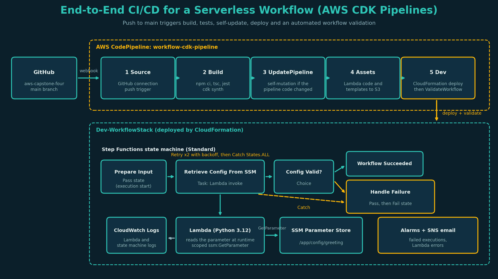
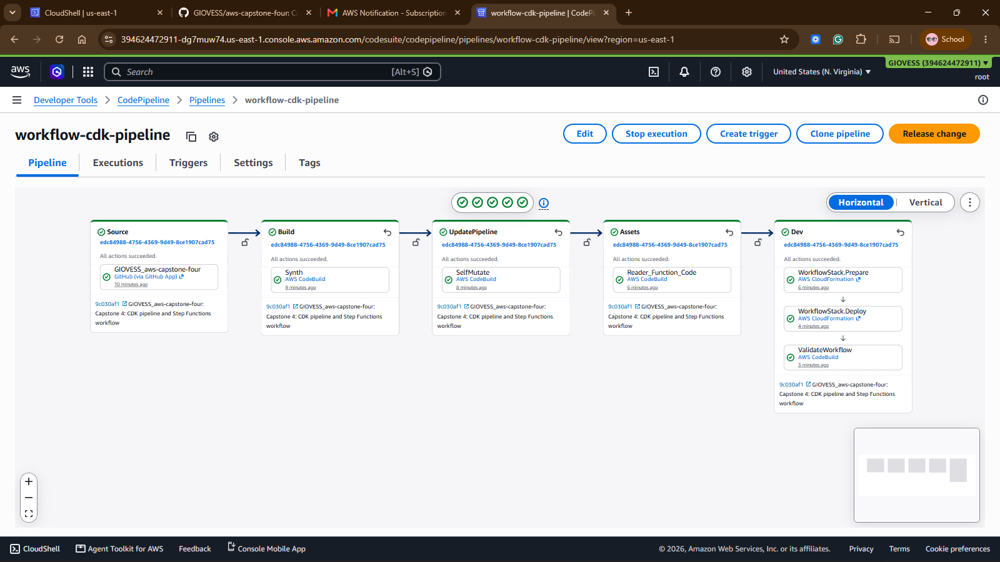
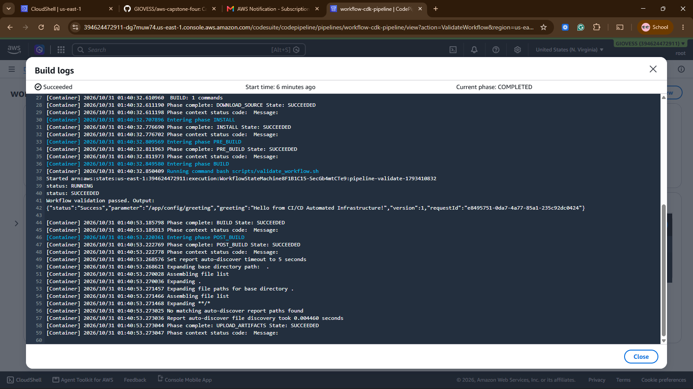
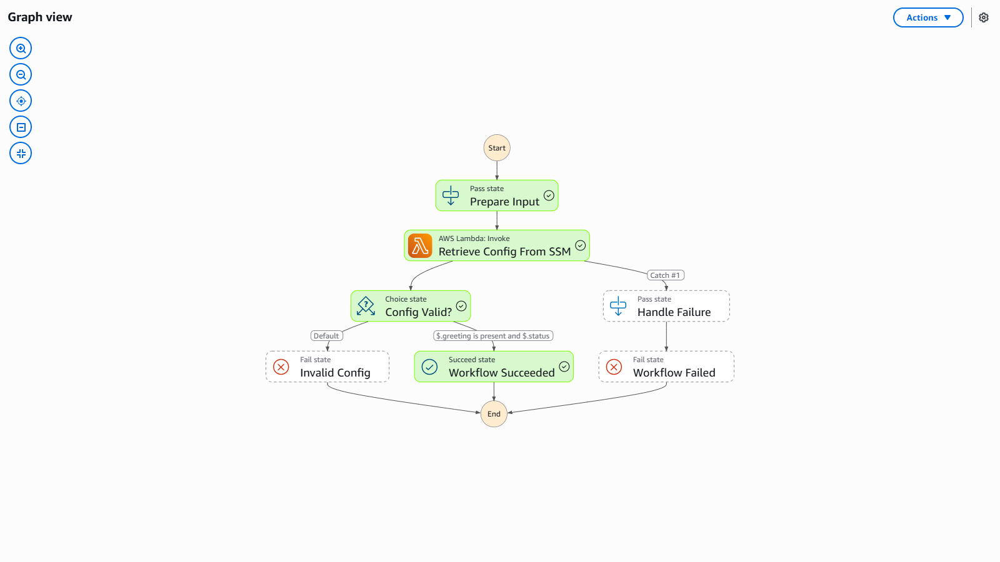
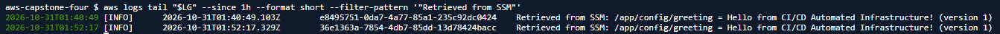
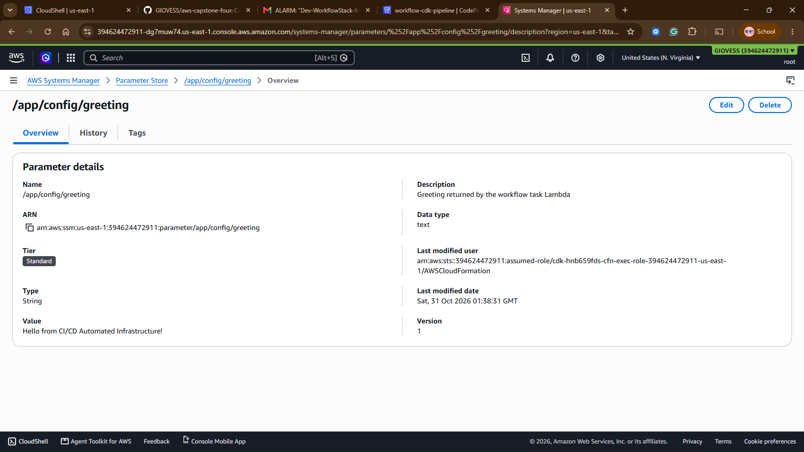
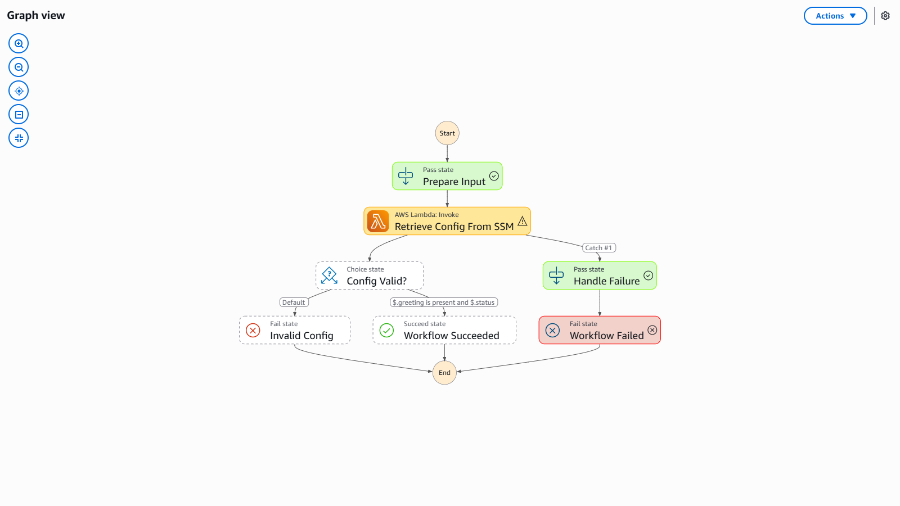
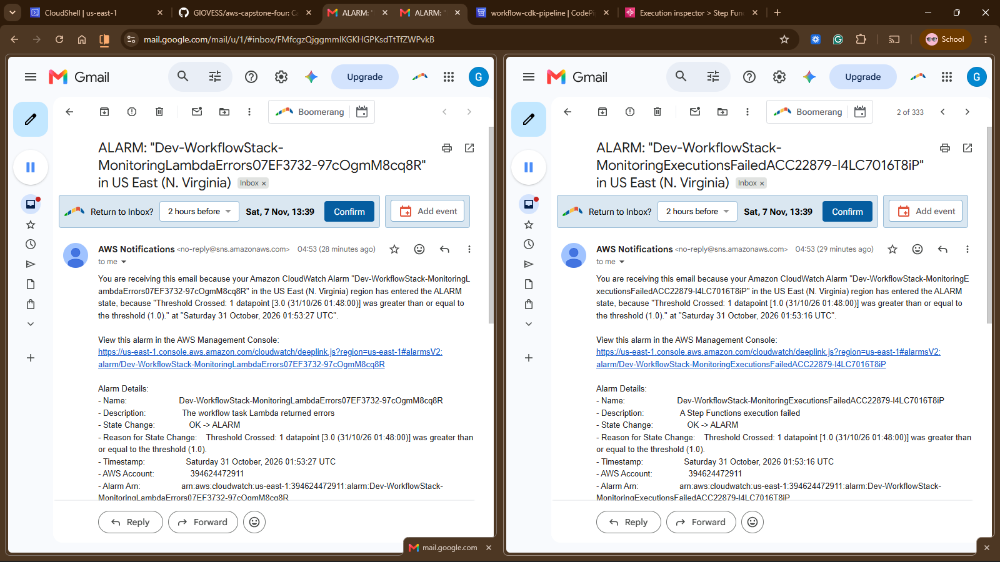
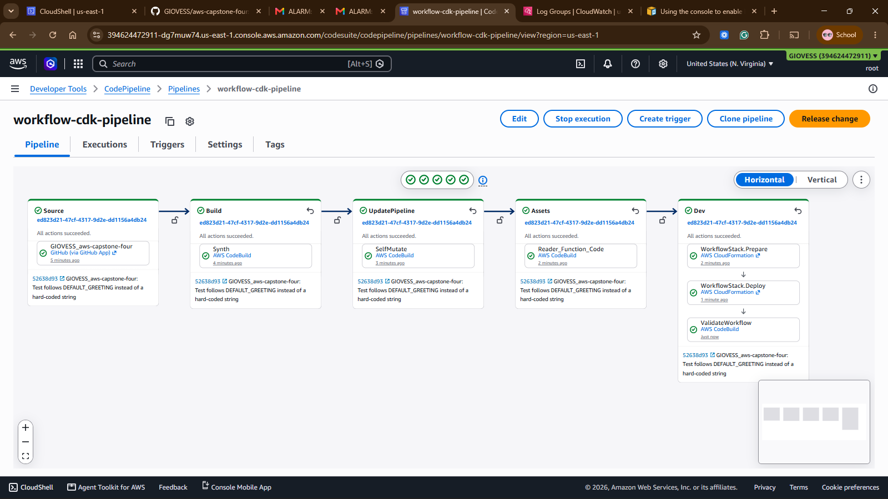
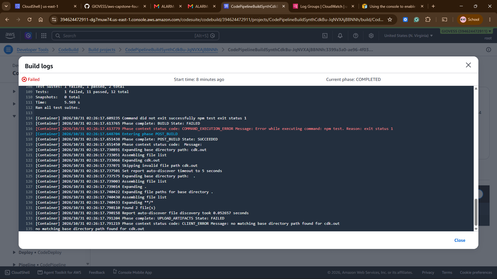

# Capstone 4: Advanced IaC and Automated Workflows

A serverless workflow defined entirely in AWS CDK (TypeScript) and deployed by a self-mutating CDK Pipeline. Every push to `main` is built, tested, deployed and validated automatically. The workflow is an AWS Step Functions state machine that invokes a Lambda function, which reads its configuration from SSM Parameter Store at runtime.



## What is deployed

| Layer | Resource | Details |
|---|---|---|
| CI/CD | CodePipeline `workflow-cdk-pipeline` | Source (GitHub connection), Build (`npm ci`, `tsc`, `jest`, `cdk synth`), UpdatePipeline (self-mutation), Assets, Dev deploy, then a validation step |
| Configuration | SSM parameter `/app/config/greeting` | Defined in CDK, read by the Lambda at runtime |
| Compute | Lambda `index.handler`, Python 3.12 | Reads the parameter with boto3 and logs the value. Read access is limited to that one parameter |
| Orchestration | Step Functions (Standard) | `Prepare Input` (Pass), `Retrieve Config From SSM` (Task with Retry and Catch), `Config Valid?` (Choice), then Succeed or Handle Failure and Fail |
| Observability | CloudWatch Logs, alarms, dashboard, SNS | Lambda and state machine logs, alarms on failed executions and Lambda errors, email notifications, X-Ray tracing on both |

## Design decisions

| Decision | Reason |
|---|---|
| CDK Pipelines (self-mutating) | Pipeline changes ship through the same pipeline. A commit that edits the pipeline updates it before deploying |
| Small constructs (`AppConfig`, `ConfigReaderFunction`, `Workflow`, `Monitoring`) composed in one stack, one stage | Modular, individually testable, reusable for another environment by adding a stage |
| Parameter name passed to the Lambda as an environment variable that references the SSM resource | The code, the IAM grant and the parameter cannot drift apart |
| `parameter.grantRead(fn)` | Least privilege: `ssm:GetParameter` on this parameter only, no wildcard |
| Retry with exponential backoff, then Catch to a handler and a Fail state | Transient errors recover on their own. Persistent errors end in a clear failed execution and an alarm |
| `ValidateWorkflow` pipeline step | After deploying, the pipeline starts a real execution and fails unless it SUCCEEDS, so a broken deployment is caught by the pipeline |
| Deployment settings (connection ARN, repo, alert email) injected as pipeline environment variables | No account specific values or email addresses are committed to the public repository |
| Own artifact bucket with `autoDeleteObjects` | Private, encrypted, TLS only, and emptied and removed automatically when the stack is deleted |
| Pinned `aws-cdk-lib` and CLI versions | The CLI inside the pipeline matches the library, so synth is reproducible |
| Unit tests read the greeting from `lib/config.ts` | Changing the greeting is a normal change and must not fail the build |

## Repository layout

```
bin/app.ts                                CDK app entry point (reads deployment settings from the environment)
lib/pipeline-stack.ts                     Self-mutating CDK Pipeline
lib/workflow-stage.ts                     Deployable stage used by the pipeline
lib/workflow-stack.ts                     Stack composing the constructs below
lib/constructs/app-config.ts              SSM parameter
lib/constructs/config-reader-function.ts  Lambda, log group, least-privilege grant
lib/constructs/workflow.ts                Step Functions state machine (ASL generated by CDK)
lib/constructs/monitoring.ts              Alarms, SNS topic, dashboard
lib/config.ts                             Parameter name, default greeting, default repo
lambda/index.py                           Lambda source (SSM retrieval)
scripts/validate_workflow.sh              Pipeline validation step
test/                                     Jest tests for both stacks, pytest tests for the Lambda
package.json, cdk.json, tsconfig.json, jest.config.js   Project configuration (versions are pinned)
architecture-diagram.png                  Generated by docs/make_diagram.py
docs/screenshots/                         Evidence
```

## Deploy from CloudShell (us-east-1)

Prerequisites: Node.js 20 or newer (`node -v`), a GitHub connection, and this repository pushed to GitHub, because the pipeline's first run pulls the code from there.

1. Create the connection once: Developer Tools, Settings, Connections, Create connection, GitHub. Authorize it and wait for the status **Available**.

2. Deploy the pipeline (the only manual deployment, everything after this is automatic):

```bash
git clone https://github.com/GIOVESS/aws-capstone-four.git && cd aws-capstone-four
npm ci

# Look up the connection ARN instead of typing it
export CONNECTION_ARN=$(aws codeconnections list-connections --provider-type-filter GitHub \
  --query "Connections[?ConnectionStatus=='AVAILABLE']|[0].ConnectionArn" --output text)
echo "$CONNECTION_ARN"                       # must print a full arn:aws:codeconnections:... value
export ALERT_EMAIL=you@example.com          # optional, receives alarm emails

ACCOUNT_ID=$(aws sts get-caller-identity --query Account --output text)
npx cdk bootstrap aws://$ACCOUNT_ID/us-east-1      # once per account and region
npx cdk deploy WorkflowPipelineStack --require-approval never
```

3. Open CodePipeline, `workflow-cdk-pipeline`. It starts on its own. Wait for Source, Build, UpdatePipeline, Assets and Dev to turn green (several minutes the first time). Confirm the SNS subscription email, then check it:

```bash
aws sns list-subscriptions --query 'Subscriptions[].[Endpoint,SubscriptionArn]' --output table
```

A full ARN means confirmed. `PendingConfirmation` means no emails will arrive. The subscription only exists after the Dev stage has deployed.

## Run the workflow

```bash
SM=$(aws cloudformation describe-stacks --stack-name Dev-WorkflowStack \
  --query "Stacks[0].Outputs[?OutputKey=='StateMachineArn'].OutputValue" --output text)

# success path
aws stepfunctions start-execution --state-machine-arn "$SM" --name "demo-ok-$(date +%s)" --input '{}'

# failure path: the Lambda raises an error, Step Functions retries twice, then catches and fails the execution
aws stepfunctions start-execution --state-machine-arn "$SM" --name "demo-fail-$(date +%s)" --input '{"simulateFailure": true}'
```

To see the graph: Step Functions, State machines, the `WorkflowStateMachine...` entry, Executions tab, then open an execution. The page has Graph view, Table view and Event view tabs. The Lambda log lines:

```bash
FN=$(aws cloudformation describe-stacks --stack-name Dev-WorkflowStack \
  --query "Stacks[0].Outputs[?OutputKey=='FunctionName'].OutputValue" --output text)
LG=$(aws lambda get-function-configuration --function-name "$FN" --query LoggingConfig.LogGroup --output text)
aws logs tail "$LG" --since 30m --format short
```

Expected line (the version number increases each time the greeting changes):
`Retrieved from SSM: /app/config/greeting = Hello from CI/CD Automated Infrastructure! (version 1)`

## Prove the CI/CD loop

Change `DEFAULT_GREETING` in `lib/config.ts`, commit and push to `main`. The pipeline starts by itself, passes Build, deploys, and `ValidateWorkflow` runs a new execution. The next Lambda log line then shows the new value and the next parameter version.

## Tests

```bash
npm test                                   # 12 Jest tests: stacks, IAM scope, state machine, pipeline stages
pip install pytest boto3 && python -m pytest test/python -q    # 4 Lambda unit tests
```

The same Jest suite runs inside the pipeline's Build stage, so a failing test blocks deployment.

## Monitoring

| Signal | Mechanism |
|---|---|
| Failed Step Functions execution | Alarm `ExecutionsFailed` then SNS email |
| Lambda errors | Alarm `LambdaErrors` then SNS email |
| Logs | Lambda log group and `/aws/vendedlogs/states/capstone4-workflow` (execution data included) |
| Traces | X-Ray on Lambda and Step Functions |
| Overview | CloudWatch dashboard with executions and Lambda invocations and errors |

Emails are sent when an alarm enters the ALARM state. The alarms return to OK on their own once failures stop.

## Evidence

Screenshots were captured from the deployed environment in us-east-1.

### CodePipeline execution: Source, Build, UpdatePipeline, Assets and Dev all succeeded


### ValidateWorkflow step: the pipeline started an execution and it SUCCEEDED


### Step Functions: visual graph of a successful execution


### CloudWatch Logs: the Lambda retrieving the value from SSM Parameter Store


### The SSM parameter defined by the stack


### Error handling: retries and the catch path (`simulateFailure`)

The Lambda was invoked three times (01:52:21, 01:52:23 and 01:52:27 UTC): the first attempt plus two retries with 2 s and 4 s backoff. The Catch then routed to Handle Failure and the execution ended in Workflow Failed.



### Alarm notification

Both alarms (`ExecutionsFailed` and `LambdaErrors`) emailed after the failure run.



### CI/CD loop: a push to main triggers a new run and the new value appears in the logs


### Quality gate: a failing test blocks the deployment

The first push of the greeting change failed the Build stage, because a unit test had the old greeting hard-coded. Nothing was deployed. The test was changed to read the greeting from `lib/config.ts`, and the next push passed and deployed.



## Teardown

```bash
aws cloudformation delete-stack --stack-name Dev-WorkflowStack
aws cloudformation wait stack-delete-complete --stack-name Dev-WorkflowStack
aws cloudformation delete-stack --stack-name WorkflowPipelineStack   # also empties its artifact bucket
aws cloudformation wait stack-delete-complete --stack-name WorkflowPipelineStack
aws codeconnections delete-connection --connection-arn "$CONNECTION_ARN"

# CodeBuild log groups are created outside CloudFormation. List them, then delete the ones from this pipeline
aws logs describe-log-groups --log-group-name-prefix /aws/codebuild/ --query 'logGroups[].logGroupName' --output text
```

Optional, only if you will not use CDK again in this account: delete the `CDKToolkit` stack after emptying the `cdk-hnb659fds-assets-<account>-us-east-1` bucket (it is versioned) and deleting the `cdk-hnb659fds-container-assets-<account>-us-east-1` repository.

## Troubleshooting

| Symptom | Cause and fix |
|---|---|
| Source stage fails | The connection is not Available, or the repository is empty. Push the code, then Release change in CodePipeline |
| Build fails on `npm test` | A test failed. The pipeline did its job. Fix the test and push |
| Build ends with `no matching base directory path found for cdk.out` | Side effect of an earlier failure in the same build. Read the log above it for the real error |
| `CONNECTION_ARN is not set` | Export the variable before `cdk deploy`. If you typed the ARN by hand, make sure no `<placeholder>` text was left in it |
| Validation step fails | Open the failed step logs for the execution status, then the execution event history in Step Functions |
| No alarm emails | The subscription is `PendingConfirmation`. Confirm the email or resubscribe |
| Warnings about Node 20 or `npm audit` | Harmless here. Do not run `npm audit fix --force`, it would change the pinned versions |
